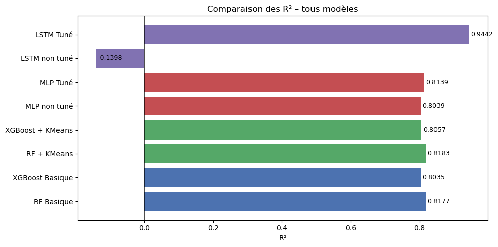
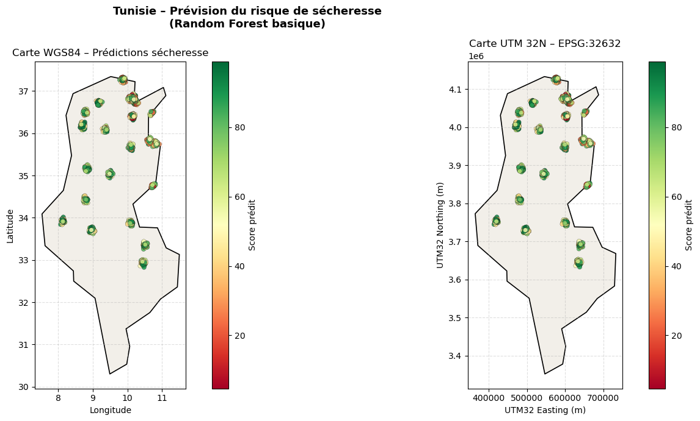

# Drought Risk Forecasting

Forecasting drought risk across Tunisian governorates from climate and environmental data, moving from baseline models to an LSTM and a prediction map.

**Notebook:** [`ex16_secheresse_notebook.ipynb`](ex16_secheresse_notebook.ipynb) · **Report (French):** [`rapport_secheresse.pdf`](rapport_secheresse.pdf)

## Data

2,520 monthly records with 32 columns. The tabular models use 14 numeric features covering date, population, climate, vegetation (NDVI), pressure scores and the observed index with its rolling means.

Two targets are used: `target_stage1_tabular_score` for the tabular models and `lstm_drought_next_3m` for the LSTM.

## Approach

1. **Baseline:** Random Forest and XGBoost on the tabular features, with an 80/20 random split.
2. **Clustering:** KMeans with k = 4, chosen with the elbow method, added as a feature.
3. **Neural network:** an MLP in Keras, with a manual search over 4 configurations.
4. **Sequence model:** an LSTM on sliding windows of 6 features, with a search over 5 configurations of window size and architecture.
5. **Mapping:** Random Forest predictions mapped in WGS84 and UTM 32N (EPSG:32632), after checking the coordinates with `pyproj`.

## Results

| Model | Target | MAE | RMSE | R² |
| --- | --- | --- | --- | --- |
| Random Forest | Tabular score | 8.791 | 10.998 | 0.8177 |
| XGBoost | Tabular score | 9.168 | 11.418 | 0.8035 |
| Random Forest + KMeans | Tabular score | 8.790 | 10.980 | 0.8183 |
| XGBoost + KMeans | Tabular score | 9.098 | 11.353 | 0.8057 |
| MLP | Tabular score | 9.064 | 11.407 | 0.8039 |
| MLP, tuned | Tabular score | 8.793 | 11.113 | 0.8139 |
| LSTM | 3-month risk | 20.769 | 24.515 | -0.1398 |
| **LSTM, tuned** | 3-month risk | 4.363 | 5.423 | 0.9442 |

- **Tabular models are close:** they all reach R² 0.80 to 0.82, and KMeans adds almost nothing.
- **The LSTM depends heavily on tuning:** across configurations, R² ranges from -0.37 to 0.94.
- **The LSTM uses a different target:** its R² can't be compared directly with the tabular models.

The map's color scale shows higher scores in green.

## Limitations

- **Test-set tuning:** the best LSTM configuration was selected on the test set, so R² 0.94 is optimistic.
- **Data leakage risks:** scalers and KMeans are fitted on all rows, including the test rows. The random split also places neighboring months of the same series in both training and test sets.
- **LSTM windows ignore location:** sequences are built across the whole table in row order, so a window can span two governorates. The last 20% of rows is the test set, which may not be a true split by time.

## Run it

Place `ex16_secheresse_spi.csv` in this folder, install the packages from the root `requirements.txt`, then open `ex16_secheresse_notebook.ipynb` and run all cells. The map step downloads the Tunisia outline from Natural Earth, so it needs internet access.
