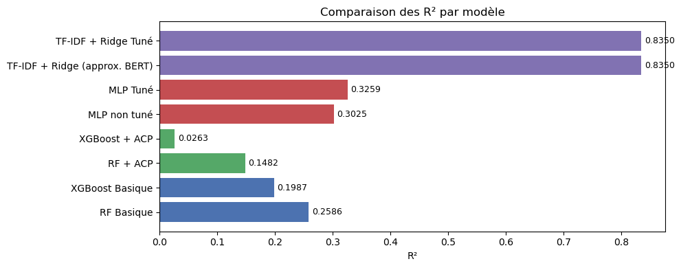
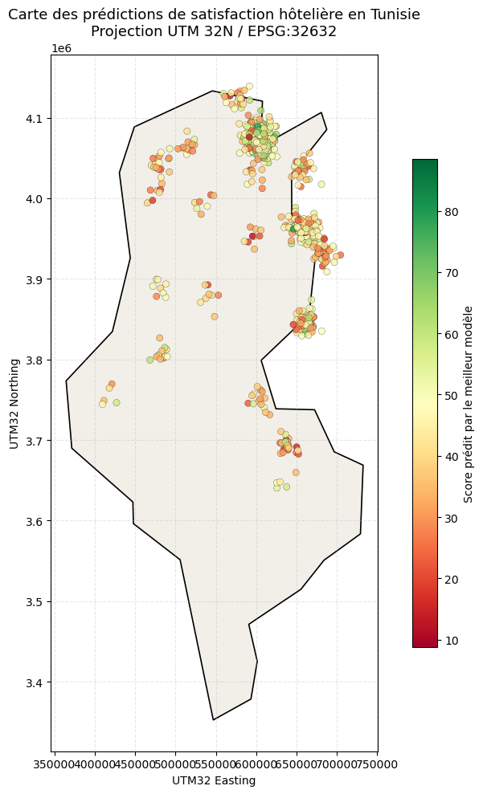

# Hotel Satisfaction Modeling

Predicting hotel satisfaction scores in Tunisia from tabular and French text data, moving from baseline models to text modeling and a prediction map.

**Notebook:** [`ex06_avis_hoteliers_notebook.ipynb`](ex06_avis_hoteliers_notebook.ipynb) · **Report (French):** [`rapport_avis_hoteliers.pdf`](rapport_avis_hoteliers.pdf)

## Data

900 records with 25 columns, split 80/20 into 720 training and 180 test rows. Inputs are 10 numeric variables covering population, climate, accessibility, service load, economic pressure and date, plus the French review text in `text_fr`.

Two targets are used: `target_stage1_tabular_score` for the tabular models and `text_hotel_score` for the text model.

## Approach

1. **Baseline:** Random Forest and XGBoost on the tabular variables.
2. **Dimensionality reduction:** the same models on PCA components covering at least 90% of the variance (6 components).
3. **Neural network:** an MLP in Keras, with a manual search over 4 configurations.
4. **Text model:** TF-IDF with Ridge regression on the reviews, with 5 values of alpha tested.
5. **Mapping:** Random Forest predictions mapped in UTM 32N (EPSG:32632), after checking the coordinates with `pyproj`.

## Results

| Model | Target | MAE | RMSE | R² |
| --- | --- | --- | --- | --- |
| Random Forest | Tabular score | 12.089 | 14.859 | 0.2586 |
| XGBoost | Tabular score | 12.529 | 15.447 | 0.1987 |
| Random Forest + PCA | Tabular score | 12.926 | 15.926 | 0.1482 |
| XGBoost + PCA | Tabular score | 13.666 | 17.028 | 0.0263 |
| MLP | Tabular score | 11.687 | 14.412 | 0.3025 |
| MLP, tuned | Tabular score | 11.490 | 14.167 | 0.3259 |
| **TF-IDF + Ridge** | Text score | 5.911 | 7.348 | 0.8350 |

- **Tabular variables explain little:** the best tabular model, the tuned MLP, reaches R² 0.33.
- **PCA hurts here:** Random Forest falls from R² 0.26 to 0.15, and XGBoost from 0.20 to 0.03.
- **Text does much better, on a different target:** the text score comes directly from the reviews, so its R² can't be compared directly with the tabular models.

## Limitations

- **Test-set tuning:** the MLP and alpha settings were selected on the test set, so the tuned scores are somewhat optimistic.
- **No BERT model:** TF-IDF + Ridge stands in for CamemBERT, which was planned but not run, so the two can't be compared.
- **Dropped map points:** 609 of 900 points remain on the map, because points outside a coarse country outline are removed.

## Run it

Place `ex06_avis_hoteliers.csv` in this folder, install the packages from the root `requirements.txt`, then open `ex06_avis_hoteliers_notebook.ipynb` and run all cells. The map step downloads the Tunisia outline from Natural Earth, so it needs internet access.
